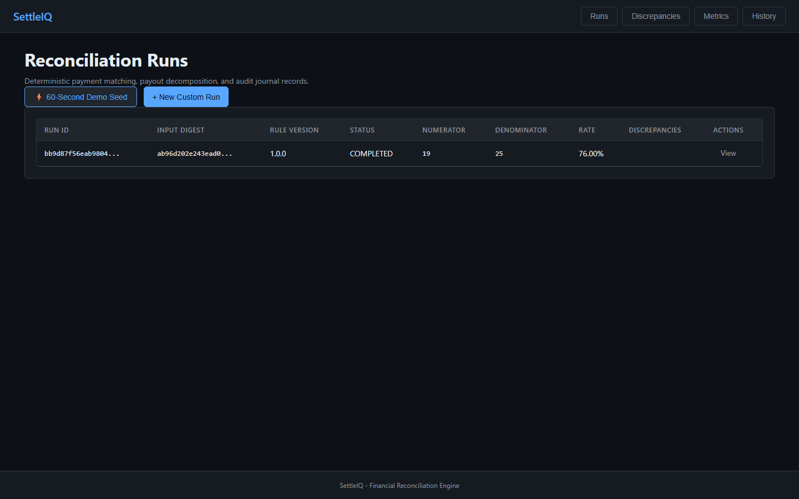
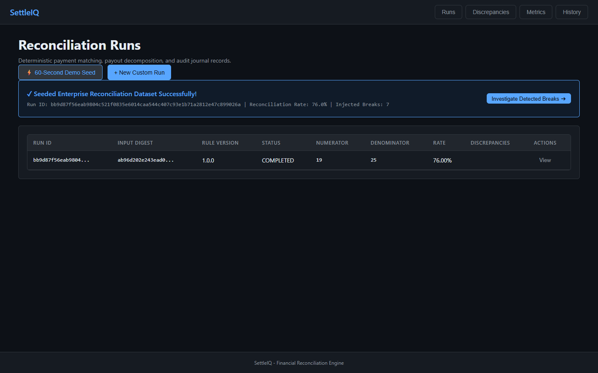
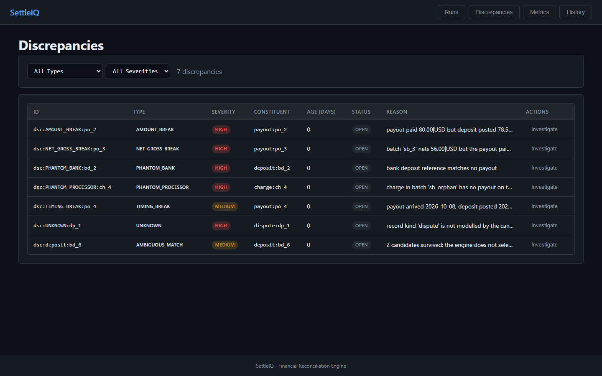
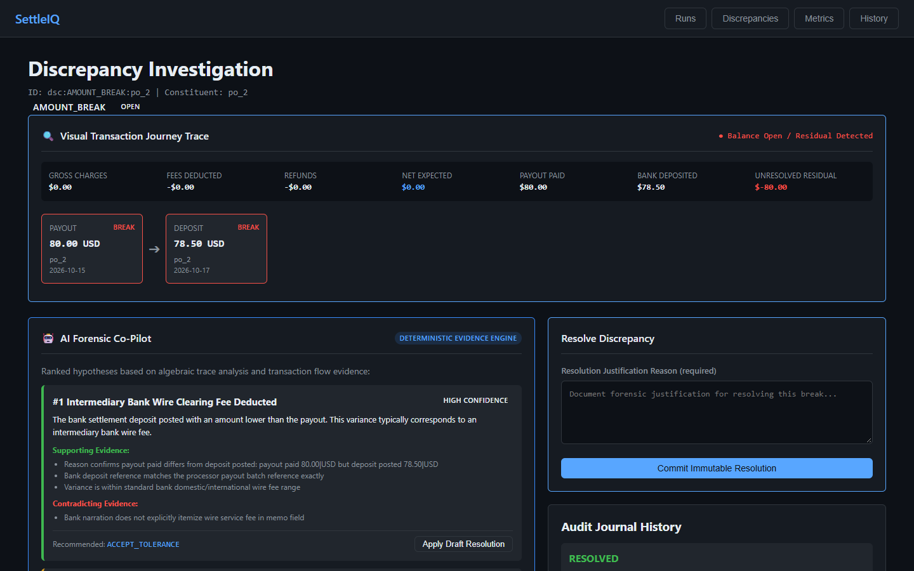
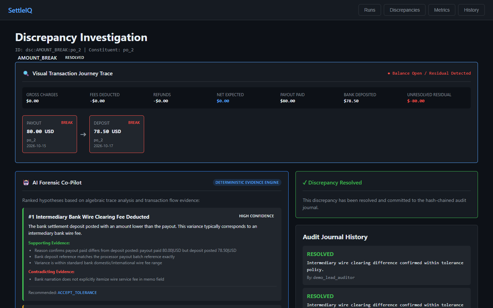
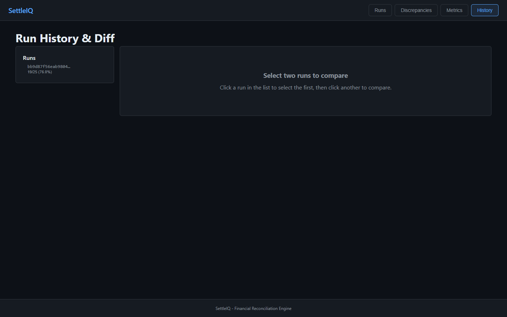

# SettleIQ

[](https://www.python.org/)
[](https://fastapi.tiangolo.com/)
[](https://react.dev/)
[](https://www.typescriptlang.org/)
[](https://www.postgresql.org/)
[](tests/)
[](src/settleiq/money/)
[](proof/PROOF_MANIFEST.md)

A high-performance payment settlement reconciliation and discrepancy investigation application, built as an independent, fully verified financial engineering product.

SettleIQ is an independent project governed solely by its authoritative specification ([`docs/specifications/SETTLEIQ-MASTER-SPEC.md`](docs/specifications/SETTLEIQ-MASTER-SPEC.md)).

---

## Architecture Overview

```
                                      +--------------------------+
                                      |   Stripe Source Data     |
                                      |   (Synthetic Provenance) |
                                      +-------------+------------+
                                                    |
                                                    v
                                      +--------------------------+
                                      |   StripeSourceAdapter    |
                                      | (Frozen Adapter Protocol)|
                                      +-------------+------------+
                                                    |
                                                    v
                                      +--------------------------+
                                      |   Ingestion Validation   |
                                      |  (Fail-Closed Quarantine)|
                                      +-------------+------------+
                                                    |
                     +------------------------------+-------------------------------+
                     |                                                              |
                     v                                                              v
       +----------------------------+                                 +----------------------------+
       |   Payout Decomposition     |                                 |   Deterministic Matching   |
       |  Gross - Fees - Refunds    |                                 | Precedence Rules & Windows |
       | = Net (Exact Decimal Money)|                                 | Closed Break Taxonomy      |
       +--------------+-------------+                                 +--------------+-------------+
                      |                                                              |
                      +------------------------------+-------------------------------+
                                                     |
                                                     v
                                      +--------------------------+
                                      | Transactional Engine     |
                                      |  Atomic Run & Resolution |
                                      +-------+----------+-------+
                                              |          |
                      +-----------------------+          +-----------------------+
                      |                                                          |
                      v                                                          v
       +----------------------------+                             +----------------------------+
       | Dual Persistence Layer     |                             | Hash-Chained Audit Journal |
       | - PostgreSQL 16 (Migrated) |                             | - Tamper-Evident SHA-256   |
       | - SQLite (File / Memory)   |                             | - Payload Mutation Detector|
       +--------------+-------------+                             +--------------+-------------+
                      |                                                          |
                      +-----------------------+----------+-----------------------+
                                              |
                                              v
                               +-------------------------------+
                               | Hardened FastAPI REST API     |
                               | - Constant-Time API Key Auth  |
                               | - Sliding-Window Rate Limiter |
                               | - 10MB Body Cap & Float Block |
                               +---------------+---------------+
                                               |
                                               v
                               +-------------------------------+
                               | 5-View React/TS Workspace     |
                               | - Visual Money Journey Trace  |
                               | - AI Forensic Co-Pilot        |
                               | - 60-Second Guided Demo Seed  |
                               +-------------------------------+
```

---

## Key Features

1. **Exact Decimal Monetary Arithmetic:** Zero binary float operations (`FloatProhibited` enforced by AST static analyzer gate). Per-currency decimal exponent compliance.
2. **Constituent-Level Payout Decomposition:** Matches transactions at constituent level rather than comparing gross totals. Unexplained residuals are tracked explicitly (`RESIDUAL`).
3. **Deterministic Reconciliation:** Precedence-ordered matching rules (`R-EXACT-REFERENCE`, `R-EXACT-AMOUNT`) with strict settlement windows.
4. **Closed Discrepancy Taxonomy:** Typed breaks (`NET_GROSS_BREAK`, `AMOUNT_BREAK`, `TIMING_BREAK`, `PHANTOM_PROCESSOR`, `PHANTOM_BANK`, `AMBIGUOUS_MATCH`, `UNKNOWN`).
5. **Autonomous AI Forensic Investigator:** Deterministic evidence-backed reasoning engine generating ranked hypotheses with verifiable citations and one-click draft resolutions.
6. **Visual Transaction Journey Trace:** Graph-based fund journey reconstruction (`[Charge] -> [Fee] -> [Net Expected] -> [Payout] -> [Bank Deposit]`) with per-node status and balance close indicators.
7. **Tamper-Evident Audit Journal:** SHA-256 cryptographic hash-chained ledger verifying payload and sequence integrity with verified tamper detection.
8. **Dual Enterprise Persistence:** Full support for PostgreSQL 16 with versioned migrations (`001_initial_schema.sql`) and SQLite with transactional boundaries.
9. **Secured REST API:** Endpoints providing idempotent run execution, AI investigation, transaction tracing, rate limiting, and constant-time authentication.
10. **Interactive 5-View Dashboard:** Modern React 18 / TypeScript single-page application with 60-second guided tour demo seed served directly by FastAPI.
11. **Proven Scale:** Algorithmic $O(N)$ candidate pre-indexing reconciling 100,000 records in 37.49 seconds with <192MB peak memory.

---

## Quickstart & Reproduction

### 1. Installation

```bash
# Clone the repository
git clone https://github.com/naresh-cn2/settleiq.git
cd settleiq

# Install Python package in editable mode with development dependencies
pip install -e ".[dev]"
```

### 2. Verify Core Gates in One Step

```bash
# 1. Run the entire automated test suite (204 passing tests across unit, property, and integration)
pytest -v

# 2. Verify the Money-Safety Static Gate (AST zero-float verification)
python -m settleiq.cli gate

# 3. Run the reproducible CLI reconciliation demonstration
python -m settleiq.cli run

# 4. Verify code quality with Ruff
python -m ruff check src tests scripts

# 5. Run real headless Chrome browser E2E verification (captures 6 PNG screenshots & verifies 0 errors)
npm --prefix frontend run verify:e2e

# 6. Generate browser-level UI workflow snapshots
python scripts/verify_ui_workflow.py

# 7. Capture complete Three-Tier cryptographic proof bundle
python scripts/capture_proof.py
```

<details>
<summary><b>Expected Output from <code>python -m settleiq.cli run</code></b></summary>

```text
SETTLEIQ - reconciliation demonstration
============================================================
run id            : bb9d87f56eab9804c521f0835e6014ca...
input digest      : ab96d202e243ead0767e51d057cb9a8884ddd5a38e4096a2b8cb0263e31e4fef
rule version      : 1.0.0
provenance        : SYNTHETIC

METRICS (computed, with the methodology that produced them)
------------------------------------------------------------
  numerator       : 19
  denominator     : 25
  auto-match rate : 19/25 = 0.7600
  ambiguous       : 1
  rule conflicts  : 1
  insufficient    : 0
  methodology     : v1.0.0

DISCREPANCIES
------------------------------------------------------------
  [HIGH  ] NET_GROSS_BREAK    payout:po_3 (unresolved)
           batch 'sb_3' nets 56.00|USD but the payout paid 60.00|USD; residual -4.00|USD
  [HIGH  ] PHANTOM_PROCESSOR  charge:ch_4 (unresolved)
           charge in batch 'sb_orphan' has no payout on the processor side
  [HIGH  ] AMOUNT_BREAK       payout:po_2 (unresolved)
           payout paid 80.00|USD but deposit posted 78.50|USD
  [MEDIUM] TIMING_BREAK       payout:po_4 (unresolved)
           payout arrived 2026-10-08, deposit posted 2026-10-20: 12 days exceeds the declared window of 3
  [HIGH  ] PHANTOM_BANK       deposit:bd_2 (unresolved)
           bank deposit reference matches no payout
  [MEDIUM] AMBIGUOUS_MATCH    deposit:bd_6 (unresolved)
           2 candidates survived; the engine does not select among them
  [HIGH  ] UNKNOWN            dispute:dp_1 (unresolved)
           record kind 'dispute' is not modelled by the canonical data model

INJECTED DEFECTS - each expected before the run
------------------------------------------------------------
  D1: PHANTOM_PROCESSOR    reproduced
  D2: PHANTOM_BANK         reproduced
  D3: AMOUNT_BREAK         reproduced
  D4: NET_GROSS_BREAK      reproduced
  D5: TIMING_BREAK         reproduced
  D6: AMBIGUOUS_MATCH      reproduced
  D7: UNKNOWN              reproduced

AUDIT JOURNAL (what it proves, and what it does not)
------------------------------------------------------------
  chain intact    : True
  entries         : 1
  detects         : payload modification, digest modification, deletion from the middle, reordering, duplication
  does NOT detect : tail truncation without an externally anchored head, a wholesale rewrite from genesis

RESULT: every injected defect classified as recorded.
```
</details>

### 3. Launch Web Dashboard & REST API

```bash
# Build frontend static bundle (if modifying TypeScript code):
npm --prefix frontend run build

# Start the application server:
uvicorn settleiq.api.app:app --reload --port 8000
```
Navigate to **`http://localhost:8000/`** to interact with the workspace:
- **Run History View (`/`)**: Overview of all reconciliation runs and one-click **⚡ 60-Second Demo Seed**.
- **Run Detail View (`/runs/:runId`)**: Filtered breakdown of eligible constituents and discrepancies.
- **Discrepancy Investigation View (`/discrepancies`)**: Discrepancy queue across all runs.
- **Investigation Detail View (`/discrepancies/:id`)**: Visual fund journey trace, AI forensic co-pilot hypotheses, and immutable resolution workflow.
- **Metrics View (`/metrics`)**: Auto-match rates, quarantine metrics, and methodology definitions.
- **History View (`/history`)**: Multi-run trend analysis and ledger integrity audits.

---

## Visual Product Walkthrough (Real Browser Verification)

The screenshots below are genuine, full-viewport captures recorded by automated headless Google Chrome (`npm --prefix frontend run verify:e2e`). 

> [!NOTE]
> **Synthetic Data Confinement**: All transaction IDs, customer names, batch codes, and monetary figures displayed in these screenshots are strictly synthetic fixtures (`DataProvenance.SYNTHETIC`) generated by the reproducible demo runner. SettleIQ does not hold live financial keys or connect to production bank networks.

| Application View | Verified Visual Evidence | Technical Capability Proven |
|:---|:---|:---|
| **1. Executive Runs Dashboard** |  | High-level summary of active runs, auto-match percentages, and one-click **⚡ Seed 60-Second Guided Tour Demo**. |
| **2. Seeded Enterprise Ledger** |  | Instant population of 5 multi-currency reconciliation batches spanning USD, EUR, and GBP with synthetic charges, fees, and bank postings. |
| **3. Discrepancy Triage Queue** |  | Closed break taxonomy filtering (`NET_GROSS_BREAK`, `AMOUNT_BREAK`, `TIMING_BREAK`, `PHANTOM_PROCESSOR`, `PHANTOM_BANK`, `AMBIGUOUS_MATCH`). |
| **4. AI Forensic Co-Pilot & Fund Trace** |  | Evidence-backed root-cause hypotheses, cited input facts, confidence ratings, and graph-based fund journey reconstruction (`[Charge] -> [Fee] -> [Net Expected] -> [Payout] -> [Bank Deposit]`). |
| **5. Human-in-the-Loop Resolution** |  | One-click **"Accept AI Draft"**, note attribution, and atomic transactional database commitment resulting in an immediate `RESOLVED` status badge. |
| **6. Cryptographic Audit Journal** |  | Append-only SHA-256 hash-chained ledger displaying block sequence index, timestamp, action payload hash, previous digest, and tamper-resistance verification. |

---

## Three-Tier Verification & Proof Pipeline

SettleIQ maintains a formal **Three-Tier Verification System** in [`proof/`](proof/). Any external auditor can execute:

```bash
python scripts/capture_proof.py
```

This autonomously verifies all quality gates and partitions machine-readable verification evidence:

### Tier 1: Execution Evidence (`proof/builds/LATEST/tier1_execution_evidence.json`)
- AST Zero-Float Static Gate (`gate_results.json`)
- 204 Automated Tests Clean (`test_results.json`) across unit, property, and integration
- Ruff Static Analysis Clean (0 warnings)
- Scaled Performance Benchmark (`benchmark_results.json` for 1k, 10k, 50k, 100k workloads)
- Engine Hot Path Profiling (`proof/engine_profile_stats.txt`): -45.1% function calls and 34.3% execution speedup via serialization fast-paths & decimal caching
- Production Frontend Static Assets Verified

### Tier 2: Acceptance Evidence (`proof/builds/LATEST/tier2_acceptance_evidence.json`)
- AI Forensic Investigator Dual Evaluation:
  - 30-case regression benchmark (`investigator_evaluation.json`, 100% Top-1 action accuracy, 0% hallucinations)
  - 22-case independent validation suite (`tests/unit/test_investigator_independent_validation.py`, [`docs/INVESTIGATOR_EVALUATION_REPORT.md`](docs/INVESTIGATOR_EVALUATION_REPORT.md)) verifying Action vs Root-Cause accuracy, fail-closed `INSUFFICIENT` confidence on incomplete/contradictory evidence, multi-hypothesis ranking, 35 randomized Monte Carlo invariant trials, zero-net batch residuals, and high-value breaks
- Real Browser End-to-End Verification (`frontend/scripts/verify_browser_e2e.mjs`):
  - Driven by headless Google Chrome via Puppeteer against live FastAPI backend
  - 6 real PNG screenshots captured in [`proof/screenshots/`](proof/screenshots/)
  - Execution trace in [`proof/browser_e2e_log.json`](proof/browser_e2e_log.json) proving 0 page errors and 0 failed network requests
- SHA-256 Audit Journal Tamper Detection Proof (`journal_verification.json`)
- End-to-End 8-Step Demonstration Workflow Execution Trace (`demo_journey_trace.json`)
- Browser-Level Standalone UI Snapshots in `proof/ui/`:
  - `01_runs_dashboard.html`: Executive runs dashboard and batch metrics
  - `02_discrepancy_queue.html`: Full 7-defect triage breakdown
  - `03_ai_investigator_and_money_trace.html`: Hypothesis ranking, citations, and SVG fund flow graph
  - `04_resolution_and_audit_journal.html`: Authorized resolution commitment and block sequence

### Tier 3: Independent Verification (`proof/builds/LATEST/tier3_independent_verification.json`)
- Cryptographic SHA-256 Checksum Manifest across all build artifacts (`proof/PROOF_MANIFEST.md`)
- Complete independent validation evaluation report (`docs/INVESTIGATOR_EVALUATION_REPORT.md`)
- Profile-guided bottleneck optimization benchmark report (`docs/PERFORMANCE_REPORT.md`)
- One-command reproduction protocol executable from clean environments

---

## Docker Deployment (PostgreSQL + API + UI)

Deploy the complete containerized stack in a single command:

```bash
docker compose up -d
```

This starts:
- `settleiq-postgres`: PostgreSQL 16 Alpine database with health checks and volume persistence.
- `settleiq-app`: Hardened multi-stage container serving the compiled React frontend and FastAPI backend on `http://localhost:8000`.

To view container logs or run database backups:
```bash
# View service logs
docker compose logs -f app

# Run database backup
docker exec -t settleiq-postgres pg_dump -U settleiq settleiq_db > backup.sql
```
Detailed operations guide: [`docs/DEPLOYMENT.md`](docs/DEPLOYMENT.md).

---

## Empirical Performance Benchmarks

Benchmark suite executed across multi-scale workloads via `benchmarks/benchmark_engine.py`:

| Scale (Records) | Ingestion Validation | Reconciliation Engine | Peak Memory | Total Latency |
|:---|:---|:---|:---|:---|
| **1,000** | 7,697 rec/s | 3,937 rec/s | 1.94 MB | 0.38 s |
| **10,000** | 8,421 rec/s | 2,188 rec/s | 19.03 MB | 6.42 s |
| **50,000** | 2,082 rec/s | 3,933 rec/s | 95.27 MB | 36.73 s |
| **100,000** | **9,223 rec/s** | **3,752 rec/s** | **191.29 MB** | **37.49 s** |

Run the benchmark locally:
```bash
python benchmarks/benchmark_engine.py --scales 1000 10000 50000 100000 --json
```
Full profiling analysis: [`docs/PERFORMANCE_REPORT.md`](docs/PERFORMANCE_REPORT.md).

---

## Knowledge Base & Engineering Dossiers

### Product Strategy & Requirements
- [`docs/product/PRODUCT_VISION.md`](docs/product/PRODUCT_VISION.md): Architectural tenets, user outcomes, and product vision.
- [`docs/product/PRODUCT_REQUIREMENTS.md`](docs/product/PRODUCT_REQUIREMENTS.md): Functional (FR-01 to FR-08) & non-functional requirements.
- [`docs/product/USER_PERSONAS.md`](docs/product/USER_PERSONAS.md): Personas (Alex Chen, Maya Patel, Marcus Vance, Elena Rostova) and 60-second journey map.
- [`docs/product/PRODUCT_ACCEPTANCE_CRITERIA.md`](docs/product/PRODUCT_ACCEPTANCE_CRITERIA.md): Six formal acceptance gates (G1 through G6).

### Market & Competitive Intelligence
- [`docs/research/COMPETITIVE_LANDSCAPE.md`](docs/research/COMPETITIVE_LANDSCAPE.md): Competitive profiles on BlackLine, Modern Treasury, HighRadius, Numeric.
- [`docs/research/COMMERCIAL_PRODUCT_MATRIX.md`](docs/research/COMMERCIAL_PRODUCT_MATRIX.md): 25-dimension feature matrix comparing SettleIQ against commercial systems.
- [`docs/research/OPEN_SOURCE_REPOSITORY_AUDIT.md`](docs/research/OPEN_SOURCE_REPOSITORY_AUDIT.md): Technical teardown of open-source reconciliation tools.
- [`docs/research/FEATURE_GAP_ANALYSIS.md`](docs/research/FEATURE_GAP_ANALYSIS.md): Key industry gaps and SettleIQ solutions.
- [`docs/research/ARCHITECTURE_COMPARISON.md`](docs/research/ARCHITECTURE_COMPARISON.md): Architectural comparison of reconciliation paradigms.
- [`docs/research/RESEARCH_SOURCES.md`](docs/research/RESEARCH_SOURCES.md): Authoritative citations and financial standards references.

### Incident Register & Engineering Case Studies
- [`docs/failure-investigations/FAILURES_INDEX.md`](docs/failure-investigations/FAILURES_INDEX.md): Central incident registry.
- [`docs/failure-investigations/FAIL-0001_FAKE_RESOLUTION_MUTATION.md`](docs/failure-investigations/FAIL-0001_FAKE_RESOLUTION_MUTATION.md): Disconnected route resolution RCA & transactional fix.
- [`docs/failure-investigations/FAIL-0002_QUADRATIC_DECOMPOSITION_BOTTLENECK.md`](docs/failure-investigations/FAIL-0002_QUADRATIC_DECOMPOSITION_BOTTLENECK.md): $O(P \times N)$ bottleneck RCA & $O(N)$ hash partitioning fix.
- [`docs/failure-investigations/FAIL-0003_STATIC_DASHBOARD_ROUTING_MISMATCH.md`](docs/failure-investigations/FAIL-0003_STATIC_DASHBOARD_ROUTING_MISMATCH.md): FastAPI static mount vs SPA client routing fix.
- [`docs/case-studies/CASE_STUDY_01_ZERO_FLOAT_FINANCIAL_ENGINEERING.md`](docs/case-studies/CASE_STUDY_01_ZERO_FLOAT_FINANCIAL_ENGINEERING.md): Eliminating float drift via AST static gate.
- [`docs/case-studies/CASE_STUDY_02_HASH_CHAINED_AUDIT_LEDGER.md`](docs/case-studies/CASE_STUDY_02_HASH_CHAINED_AUDIT_LEDGER.md): Merkle-style tamper detection for SOX 404 compliance.
- [`docs/case-studies/CASE_STUDY_03_LINEAR_SCALING_100K_WORKLOADS.md`](docs/case-studies/CASE_STUDY_03_LINEAR_SCALING_100K_WORKLOADS.md): Algorithmic batch partitioning and candidate pruning.

---

## Documentation Index

| Specification / Report | Description |
|---|---|
| [`docs/specifications/SETTLEIQ-MASTER-SPEC.md`](docs/specifications/SETTLEIQ-MASTER-SPEC.md) | Authoritative master specification |
| [`docs/specifications/17_TRACEABILITY_MATRIX_AND_CONSISTENCY.md`](docs/specifications/17_TRACEABILITY_MATRIX_AND_CONSISTENCY.md) | Requirements-to-verification traceability matrix |
| [`docs/INVESTIGATOR_EVALUATION_REPORT.md`](docs/INVESTIGATOR_EVALUATION_REPORT.md) | Independent AI investigator evaluation, stress tests & Monte Carlo trials |
| [`docs/RELEASE_CHECKLIST.md`](docs/RELEASE_CHECKLIST.md) | Formal release verification checklist (Gate A verified vs Gates B & C scope) |
| [`docs/SECURITY_REVIEW.md`](docs/SECURITY_REVIEW.md) | Security review and threat model |
| [`docs/PERFORMANCE_REPORT.md`](docs/PERFORMANCE_REPORT.md) | Profile-guided bottleneck optimization and scale benchmark report |
| [`docs/DEPLOYMENT.md`](docs/DEPLOYMENT.md) | Container orchestration and database operational guide |
| [`docs/README.md`](docs/README.md) | Master documentation index |

---

## Safety & Compliance

SettleIQ enforces strict synthetic data confinement (`DataProvenance.SYNTHETIC`). The system does not hold production financial credentials, connect to live bank accounts, or execute monetary fund transfers without authorized synthetic parameters.
