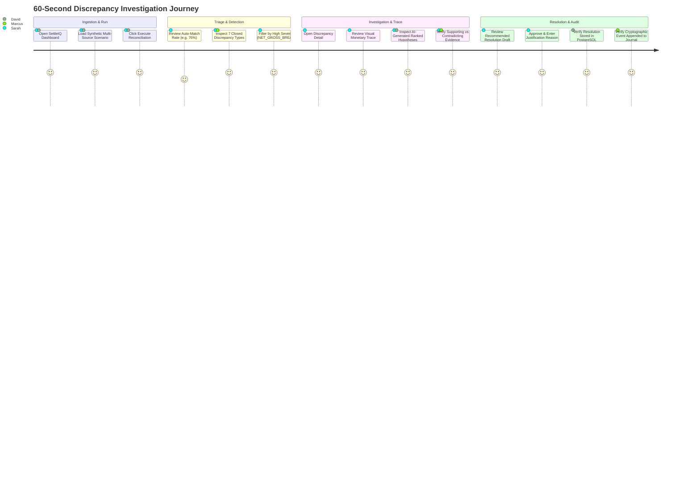

# SettleIQ — User Personas & Journey Maps

**Document ID:** SETTLEIQ-PRD-003  
**Status:** ACTIVE  

---

## 1. Primary Personas

### Persona A: Sarah — Payment Operations Lead
- **Role:** Leads payment reconciliation for a high-volume marketplace ($50M+ GMV, 400k transactions/month).
- **Core Pain Point:** Every month-end, the finance team faces a $12,000 to $45,000 discrepancy between Stripe payout totals and Chase bank statement deposits. Tracking individual missing fees or delayed refunds takes 3 full days of manual Excel vlookups.
- **Goal in SettleIQ:** Needs one-click constituent-level settlement decomposition that flags breaks immediately, identifies the exact missing fee or charge ID, and proves mathematical closure.

### Persona B: David — Fintech Backend / Platform Engineer
- **Role:** Senior engineer building ledgering infrastructure and payment integrations.
- **Core Pain Point:** Existing reconciliation tools are vendor black boxes with brittle web scrapers, float rounding errors, and opaque matching heuristics that cannot be verified or unit-tested.
- **Goal in SettleIQ:** Wants a clean, modular Python/FastAPI service with strict Decimal arithmetic, idempotent API contracts, versioned PostgreSQL migrations, and transparent $O(N)$ matching algorithms that can be embedded into an existing transactional pipeline.

### Persona C: Marcus — External Financial Auditor (SOX 404 / SOC 1)
- **Role:** Big-4 IT audit manager auditing a fintech platform's internal financial controls.
- **Core Pain Point:** Reconciliation spreadsheets can be tampered with after month-end signoff without detection. Traditional databases allow administrators to update rows in place without preserving cryptographic proof.
- **Goal in SettleIQ:** Demands an append-only, cryptographic hash-chained audit ledger that mathematically proves historical run results, discrepancy classifications, and investigator resolutions have not been edited or altered since execution.

### Persona D: Elena — Quantitative Developer / Recruiter Evaluating Engineering Depth
- **Role:** Tech lead / hiring manager reviewing an applicant's portfolio project for a senior financial systems engineering role.
- **Core Pain Point:** Weary of trivial CRUD apps, generic todo lists, and simple wrapper projects around third-party AI APIs.
- **Goal in SettleIQ:** Inspects AST-level float safety gates, $O(N)$ candidate pre-indexing, deterministic SHA-256 preimages, 100k-record benchmark methodologies, and reproducible Docker container setups.

---

## 2. Key User Journey: 60-Second Investigation Walkthrough

